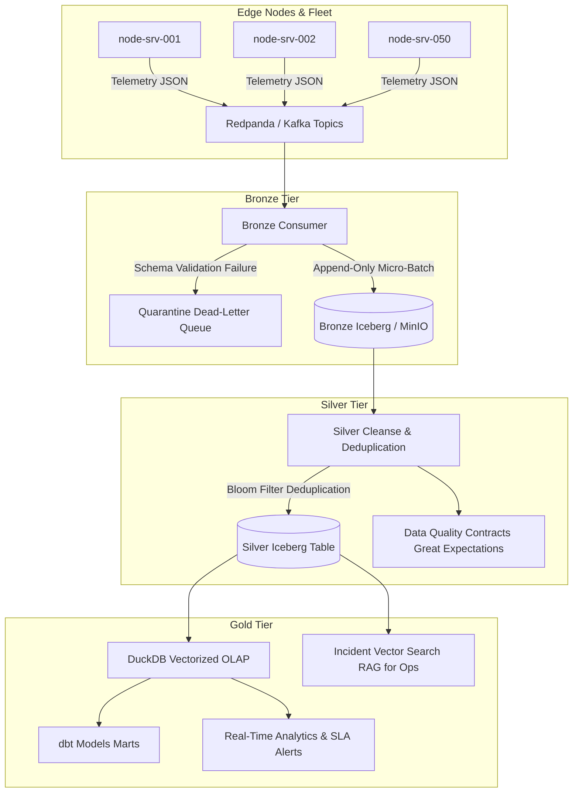

# Lakehouse Architecture & Technical Specification

## Medallion Architecture (Bronze -> Silver -> Gold)

## Key Technical Specifications

1. **Storage Format:** Apache Iceberg with Snappy-compressed columnar Parquet.
2. **Metadata Catalog:** Iceberg REST Catalog over MinIO / AWS S3.
3. **Partitioning:** Hidden partition transforms using `hours(event_timestamp)`.
4. **Idempotency Guarantee:** Non-negotiable deterministic hashing via SHA-256 fingerprinting. Replay safety guaranteed.
5. **Compute:** Embedded zero-copy OLAP query execution using DuckDB and Polars.
